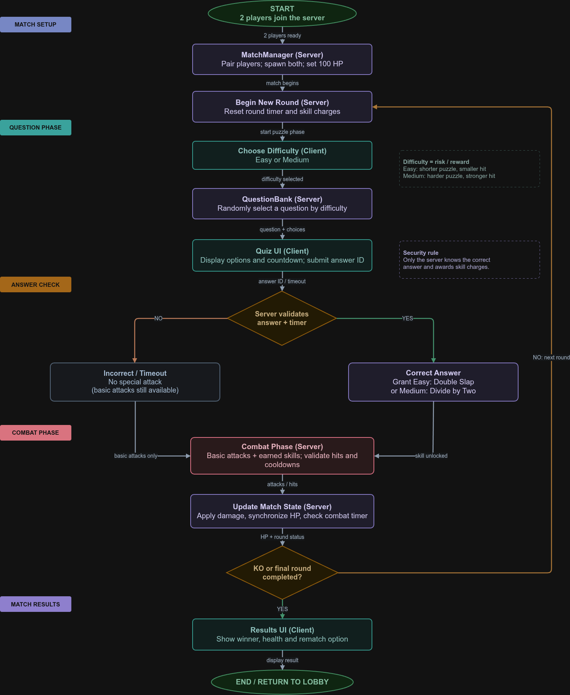

# Noob vs Senior Programmer — Project Design Document

## 1.1: The Problem 
I enjoy competitive programming and playing games with friends, but practicing algorithm problems alone can get repetitive. I sometimes lose motivation when solving problems feels more like homework than something I actually want to do. I want to make algorithm practice more entertaining by combining it with the competition and funny moments I enjoy in Roblox games.

## 1.2: My Idea (The Solution)

I want to build **Noob vs Senior Programmer**, a Roblox 1v1 fighting game where players answer randomly selected algorithm questions to unlock special attacks. Players compete in short rounds, and harder questions offer stronger attacks.

## 2.1: Eisenhower Matrix and MVP

|                   | Urgent                                                                                                                                                                                                                                      | Not urgent                                                                                                                                                                                                                                |
| ----------------- | ------------------------------------------------------------------------------------------------------------------------------------------------------------------------------------------------------------------------------------------- | ----------------------------------------------------------------------------------------------------------------------------------------------------------------------------------------------------------------------------------------- |
| **Important**     | **DO - MVP** 1. 1v1 arena and two spawns 2. Random easy/medium questions 3. Question UI and answer validation 4. Unlock Double Slap / Divide by Two 5. Health, damage, and basic attacks 6. Round timer and winner screen | **SCHEDULE - V2+** 1. 3v3 team mode and FFA 2. Full coding challenges and external judge 3. Hard questions and ultimate abilities 4. Edge Case Grenades 5. Ranked matchmaking and cosmetics 6. More maps and animations |
| **Not important** | **DELEGATE - BUILT-IN TOOLS** 1. Roblox character physics/movement 2. Roblox UI objects and layout 3. RemoteEvents for networking 4. Roblox Studio multiplayer test tools                                                       | **DELETE - CUT** 1. Large open-world map 2. Pets, trading, and currency 3. Pay-to-win attack upgrades 4. Custom physics engine 5. Full cinematic story mode                                                                |

### MVP gameplay rules

1. Two players join an arena with **100 HP** each.
2. At the start of a round, each chooses an **easy** or **medium** question.
3. The server chooses a random, unused question from the selected difficulty.
4. Each player has **25 seconds** to answer one multiple-choice question.
5. A correct easy answer unlocks **Double Slap** (moderate damage). A correct medium answer unlocks **Divide by Two** (stronger damage). Incorrect or unanswered questions grant no special attack.
6. Players enter a **45-second combat phase** using basic attacks and earned skills.
7. Repeat until somebody reaches **0 HP** or **five rounds** end. If the round limit is reached, the player with higher HP wins; equal HP is a draw.

## 2.2: Tech Stack

- Programming Language: Luau (Roblox Lua)
- Libraries, Packages, and Tools: Roblox Studio, Roblox built-in services, RemoteEvents, Roblox UI components, Roblox built-in physics, Git and GitHub.
- Visual Studio Code and Rojo.

I do not plan to use external libraries or AI APIs for the MVP.

## 2.3: Chunked Build Plan

1. Set up the project and GitHub repository
2. Build the basic battle arena
3. Create the algorithm question bank
4. Implement the question interface and answer checking
5. Implement the match and round system
6. Implement combat and special attacks
7. Add match results and victory conditions
8. Test, fix bugs, and polish the game

## 2.4: System Diagram

